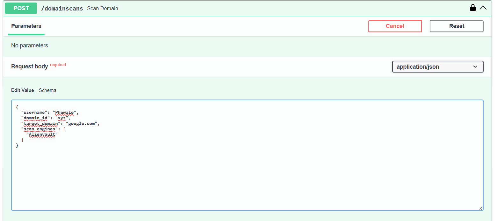

# Cybersecurity FastAPI Project

## Core Technologies


## Security Intelligence and API Integrations


## What it is

This project is an API based project written with python using the FastAPI framework.

My software is meant to allow for productivity gains by facilitating the process of conducting rudimentary threat intelligence lookup tasks, by sending an HTTP request to the appropriate endpoint. This project can be deployed onto any machine which has internet connectivity, only authorized users can then proceed to request any potential IOC be scanned and evaluated by pooling data from existing API's such as IPinfo, VirusTotal and Abuselpdb in a clean, formatted output as well as a general assessment based on the retrieved data.

It should be noted that My API only provides an opinion as well as data meant to aid a cybersecurity professional or anyone interested in conducting threat intelligence lookup, best practice guidelines should always be followed and an assessment from a single source should not be treated as the be-all and end-all.

Throughout the development of this project, I have been able to advance my knowledge and understanding of the following:

- Backend Systems
- Data Interpretation and Fusion
- Development of Secure Software
- Git Commands
- Relational Databases (Postgresql)
- Python (FastAPI)
- API's

## Why I designed it

As part of my journey into the domain of cybersecurity and programming, I learned the importance of threat intelligence and software which can provide meaningful information. I then developed an interest in the development of these software and their role in cybersecurity. At the same time, my knowledge and interest in API's was also expanding. It didn't take long before I identified a problem I believed I had the skills to to mitigate:

**How much time is spent constantly accessing and logging into websites such as IPinfo to just specify an IP address then leave onto the next website?**

I decided to create a central software which could simplify the tedious process and allow threat intelligence lookups to be conducted from anywhere as long as internet connectivity is provided.

## Directory Structure

The directory structure of the project is easy to follow and intuitive.

### main.py

This is where the main API logic is kept and where the uvicorn is run from.

### pyd_models.py

Within this file, the expected format of the json in the body of the HTTP request is specified.

There is a general HTTP json body format followed by all endpoints:

- username
- target
- optional id
- scan engines

Each endpoint expects a slightly differently named attribute but the general structure is universal.

Measures are already in place to prevent duplicate scanning as well as instances where no valid scan engine is specified.

### services

This subdirectory contains 4 python files which are used to interact with their respectice external tool:

- abuselpdb.py
- alienvault.py
- ipinfoAPI.py
- virustotal.py

### database

This subdirectory contains all database related code such as the database schema and functions used to interact with the relational database

### administrative

This subdirectory contains 3 important files:

- database_init.py, which is used to automatically create the database, all required tables and the first user
- logging.py, which is used to create logs and write them into the database
- user_man.py, which is used to perform administrative tasks relating to authorization, logs as well as the creation and deletion of users

## Endpoint structure

There are 6 endpoints, which all follow RESTful API design guidelines.

All 6 exclusively accept POST requests, their respective paths and the API's they can query are:

- /filescans (VirusTotal, Alienvault)
- /domainscans (VirusTotal, Alienvault)
- /ipscans (Abuselpdb, Alienvault, VirusTotal, Ipinfo)
- /urlscans/heavyscans (Alienvault)
- /urlscans/lightscans (VirusTotal, Alienvault)

Ipinfo is included by default for the "ipscans" endpoint, you do not have to include it into the http request.

The "urlscans" endpoint has two nested resources.

"heavyscans" sends the request to otx.alienvault.com for sandbox analysis and only a link to it is returned, it does not support any other scan engine such as virustotal.

"lighscans", this endpoint exclusively supports virustotal and alienvault, is much less comprehensive, quicker and returns an actual analysis.

## Security Features

Security measures should be implemented at all relevant layers, not just at the physical device itself. To adhere to this general guideline, I have taken several decisions to help bolster the security of the software such as:

- Implementation of logging
- Secure .env file handling
- Password enumeration mitigation techniques
- multilayered security
- Storing keys as hashes
- masked input fields for password input
- Account keys created or changed by the administrative CLI require at least 16 characters, use at least three character groups, and fit bcrypt's 72-byte input limit.

A threat may attempt to acquire information on whether or not a specific user is in the database, to help combat this, if a username does not exist, a "dummy" password is hashed and passed into bcrypt.


This feature is also implemented in the user_man.py file.

In the database, a user's respective key is stored as a hash, never plaintext. If the keys in the database are ever leaked attackers will not be able to easily decrypt them.

There are various other measures which help increase security throughout the software's code.

## Database

The data to be stored in the database was relational as the ID's of users had to match an entry in the table of logs, because of this, a relational database is prefered. This lead to me selecting Postgresql due to my existing familiarity and its open source nature.

More information on the two tables I have used is below.

### Users

This database table can be demonstrated with the following:

| Column name | Data type | Example | Column Purpose |
| --- | --- | --- | --- |
| username | string | Alex_Donald | This stores the username |
| User_id (Primary Key) | UUID7 | 01809424-3e59-7c05-9219-566f82fff672 | This stores the unique ID of a user |
| user_key | string | $2b$12$R9h/cIPz0gi.URNNX3kh2OPST9/PgBkqquzi.Ss7KIUgO2t0jWMUW | This holds the hash of the users password using bcrypt's Blowfish Cipher |
| is_admin | boolean | False | This is used to determine if that specific user has administrative authorization, mainly used by the user administration python file |


### Logs

This database table holds logs relating to scans conducted by users or general administrative actions

| Column name | Data type | Example | Column Purpose |
| --- | --- | --- | --- |
| user_id | uuid7 | 01809424-3e59-7c05-9219-566f82fff672 | This references the primary key of a user in the users table |
| timestamp | datetime (From sqlalchemy) | YYYY-MM-DD HH24:MI:SS | This holds the time that the log was recorded |
| data | JSON (string) | General JSON file highlighting the action and subject | This column stores the details of the action that occured |
| log_id | uuid7 | 18909424-4d34-7805-9219-aggf82fff672 | this holds the unique ID of that log |


The image above is an example of the a log entry in the logs table after being extracted by a function through the user_man.py file.

The keys are modified when logs are extracted for clarity reasons.


## How To Use

### How to install

The whole software is containerized with docker, simply running the following command will start the application on your machine. If docker is not installed, I recommend following the instructions on the docker website.
Installing Postgresql is NOT requred, there is already a container with a docker image included.

NOTE: For some of these commands administrative privilieges may be required.

- Clone the repository with the commands

```bash
git clone https://github.com/PhewaleZ/cybersecurity-API-project.git
cd cybersecurity-API-project
```

- Rename the .env.example file to .env
- Fill out all the environmental variables, (Please note, you will need to register with the relevant external API's to acquire your own keys)
- Run the command below

```bash
docker compose up --build -d
```

NOTE: If the credentials for the initial user do not already exist, it will be created each time the above command is run, therfore avoid constantly changing it each time the command is run.

- FastAPI's built-in documentation can be used to safely test out the endpoints, you can access the documentation with the following link once the containers are successfully running <http://127.0.0.1:8000/docs>
- Before sending request you will have to provide your API key by pressing the Authorize button, which is the same key in your .env file and which was used to create the first user of the API
- Select an endpoint then select "Try it out"

### Usage Instructions

FastAPI's built-in documentation can be used to safely test out the endpoints, you can access the documentation with the following link once the containers are successfully running <http://127.0.0.1:8000/docs>.

Before sending request you will have to provide your API key by pressing the Authorize button, which is the same key in your .env file and which was used to create the first user of the API.

Select an endpoint then select "Try it out", take note that each the "scan_engines" field can should be populated with an external API which is actually queried by that endpoint. [Availiable-External-API](#endpoint-structure)



The postgresql database data persists, even if a container or image is deleted. If you wish to reset the volume, you can run the following command
to shut down the running container and delete all data.

```bash
sudo docker compose down -v
```

### user_man.py

To access the user_man.py file, which allows for administrative management, the following command will take you into the containers file system.

```bash
sudo docker exec -it cyber_api bash
```

To run the user_man.py file, input the following command, from the main directory of the software.

```bash
python -m administrative.user_man
```

Credentials are required to access administrative features such as creating a new user, changing a users administrative authorization and extracting logs.

Upon filling out the environmental variable file, those same credentials wll create the first user with administrative privileges.

## Lessons Learned

### Type Safety

In the earlier iterations of the application, I frequently ignored pylance messages informing me that a variable may be unbound or a function may not return the specified variable type in all possible paths. I used this project as an opportunity to better understand static type checking and how to better utilize pylance to minimize logical errors in code where a variable doesn't belong to the anticipated type therefore catching errors much sooner.

### Exception Handling

At the beginning, I struggled to code an appropriate flow of try/except blocks for handling instances where an HTTP request to an external API did not return a 200 status code. This gave me the chance to improve my understanding of try/except blocks as well as how to utilize "else" and "finally". I also had to learn more about the types of errors relating to the requests module and HTTP in general. I learned about 4xx status code class, their definition, when they are returned etc.

### GitHub

An important part of the project was github, and as a result, my confidence and comfortability conducting a range of everyday github commands did improve.

Examples of commands I commonly used:

- git add
- git commit
- git log
- git push
- git status

### Modular Programming

Ensuring that functions from multiple seperate files and in seperate directories proved to be a new learning opportunity as prior to this project I had only conducted a modular programming on a smaller scale. Creating reusable functions and easy to debug as well as maintain modules, helped me better understand how to write code capable of integrating well with external software and other pieces of code internally.

### Docker

To help ensure that the application could be easily start up by anyone, containerization was required. I chose docker due to it being widely used. I learned a variety of docker commands and relating to building images and managing containers, such as:

```bash
docker image
docker ps
docker logs
docker compose up --build -d
docker compose down -v
```

In addition, the incorporation of a yaml file allowed me to also acquire hands on experience with automating the deployment of docker containers.

## Potential Improvements

### User Interface

Instead of having users conduct a post request with the linux command curl or any other alternative, providing a us interface whether CLI or GUI, would allow less tech-savvy to better understand how to make use of the software. Making the software more accessible results in a shallower learning curve, allowing individuals to quickly make use of the software without the need for complex explanations or training.

### Caching

Conducting a scan on a domain or ip address which has already been scanned is an inefficient usage of the limited API quota provided by certain IOC lookup tools, caching is something I believe could mitigate this problem by storing the results of a recent target and allowing it to be quickly retrieved by users.

## Implemented Improvements

### Async Operations

The software now supports async operations using the httpx module, resulting in better and more efficient operation.

## License

This project is licensed under the [MIT License](LICENSE).
